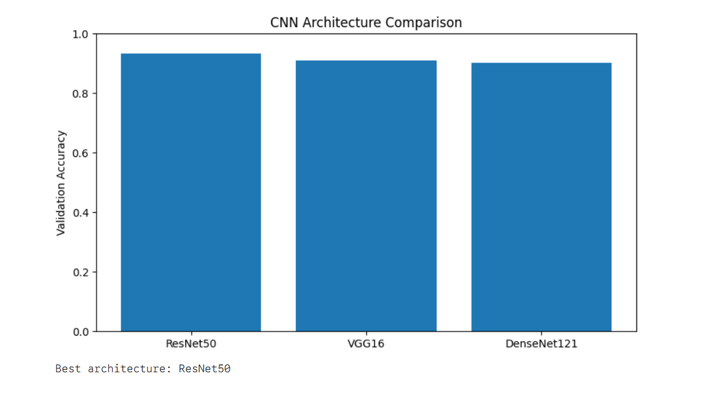
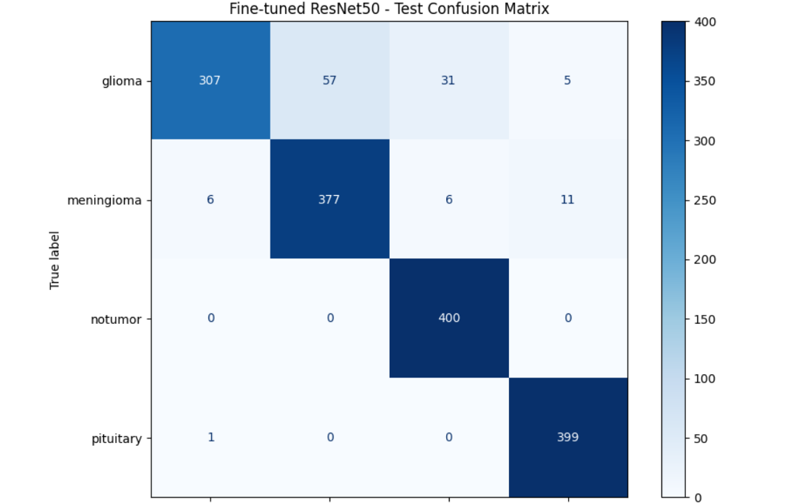
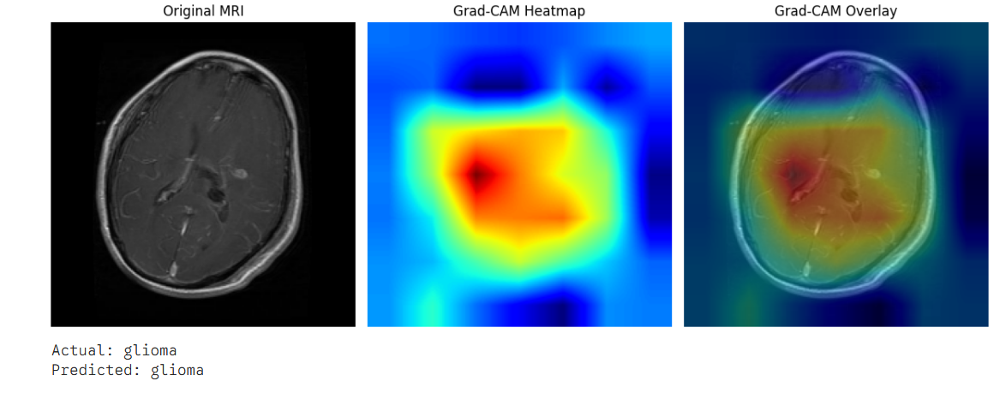

#  Brain Tumor Classification Using Deep Learning

A deep learning project for classifying brain MRI images using Transfer Learning and Convolutional Neural Networks (CNNs).

This project compares three pretrained architectures — **VGG16, ResNet50, and DenseNet121** — and further fine-tunes ResNet50 to improve classification performance.

##  Project Overview

Brain tumor classification from MRI scans is an important medical imaging task. This project explores deep learning techniques to automatically classify MRI images.

### Objectives
- Compare different pretrained CNN architectures.
- Apply transfer learning using ImageNet weights.
- Fine-tune pretrained models for improved performance.
- Evaluate models using accuracy, loss, and classification metrics.
- Visualize predictions using Grad-CAM.
- Analyze incorrectly classified MRI images.

##  Dataset

**Dataset:** [Brain Tumor MRI Dataset - Kaggle](https://www.kaggle.com/datasets/masoudnickparvar/brain-tumor-mri-dataset)

The dataset contains brain MRI images organized into training and testing directories.

- 80% of training data used for training.
- 20% of training data used for validation.
- Separate testing directory used for final evaluation.
- Input image size: 224 × 224 pixels.

##  Models Implemented

| Architecture | Approach |
|---|---|
| VGG16 | Transfer Learning |
| ResNet50 | Transfer Learning + Fine-tuning |
| DenseNet121 | Transfer Learning |

### Transfer Learning

- Used ImageNet pretrained weights.
- Froze pretrained convolutional layers.
- Added a custom classification head.
- Used Global Average Pooling, Dense layers and Dropout.
- Applied data augmentation.

### Fine-tuning

ResNet50 was further fine-tuned using:

- Unfreezing the final convolutional block.
- Keeping Batch Normalization layers frozen.
- Learning rate: `1e-5`.
- Early Stopping.
- ReduceLROnPlateau.

##  Model Performance

### Final Fine-tuned ResNet50 Test Results

| Metric | Score |
|---|---:|
| Test Accuracy | 92.69% |
| Test Loss | 0.5367 |
| Macro F1-score | 92.47% |
| Weighted F1-score | 92.47% |

### Classification Report

| Class | Precision | Recall | F1-score |
|---|---:|---:|---:|
| Glioma | 97.77% | 76.75% | 85.99% |
| Meningioma | 86.87% | 94.25% | 90.41% |
| No Tumor | 91.53% | 100.00% | 95.58% |
| Pituitary | 96.14% | 99.75% | 97.91% |

### Results and Visualizations

#### Architecture Comparison


#### Confusion Matrix


#### Grad-CAM Visualization


##  Explainability Using Grad-CAM

Gradient-weighted Class Activation Mapping (Grad-CAM) was implemented to visualize image regions contributing to the model's predictions.

This helps inspect which regions of MRI images influence the classification decision.

##  Technologies Used

- Python
- TensorFlow / Keras
- NumPy
- Pandas
- Matplotlib
- Seaborn
- OpenCV
- Scikit-learn

##  How to Run

### 1. Clone the repository

```bash
git clone https://github.com/Harsh-Anand-20-06/brain-tumor-classification-vgg16.git
cd brain-tumor-classification-vgg16
```

### 2. Install dependencies

```bash
pip install -r requirements.txt
```

### 3. Download the dataset

Download the dataset from Kaggle and configure the training and testing directory paths in the notebook.

### 4. Run the notebook

Open the notebook in Jupyter Notebook or Google Colab and execute the cells.

## Repository Structure

```text
Brain-Tumor-Classification/
│
├── notebooks/
│   └── brain-tumor-classification-vgg16.ipynb
│
├── results/
│   ├── architecture_comparison.png
│   ├── final_confusion_matrix.png
│   ├── gradcam_examples.png
│
├── README.md
├── requirements.txt
└── .gitignore
```

##  Disclaimer

This project is developed for educational purposes only. It is not clinically validated and should not be used as a substitute for professional medical diagnosis.

##  Author

**Harsh Anand**

GitHub: [GITHUB_PROFILE](https://github.com/Harsh-Anand-20-06)
